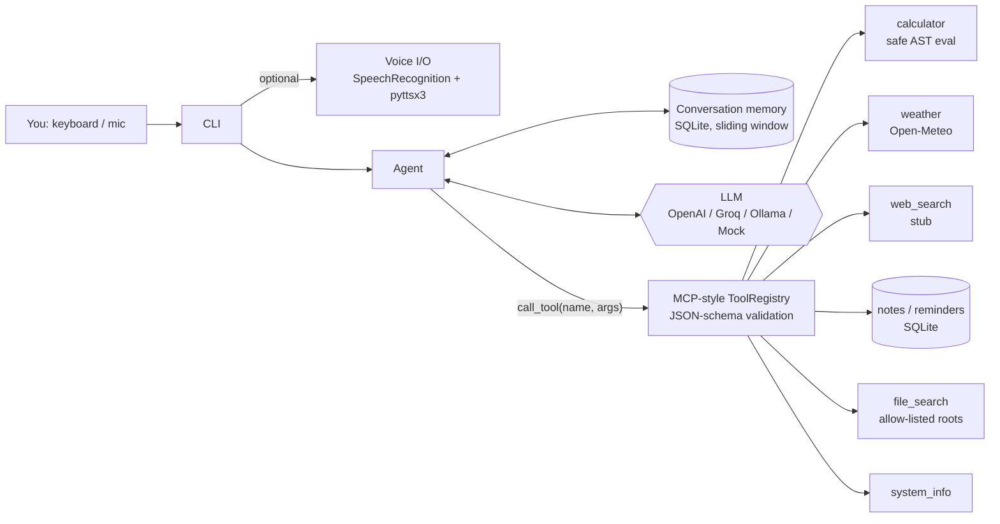
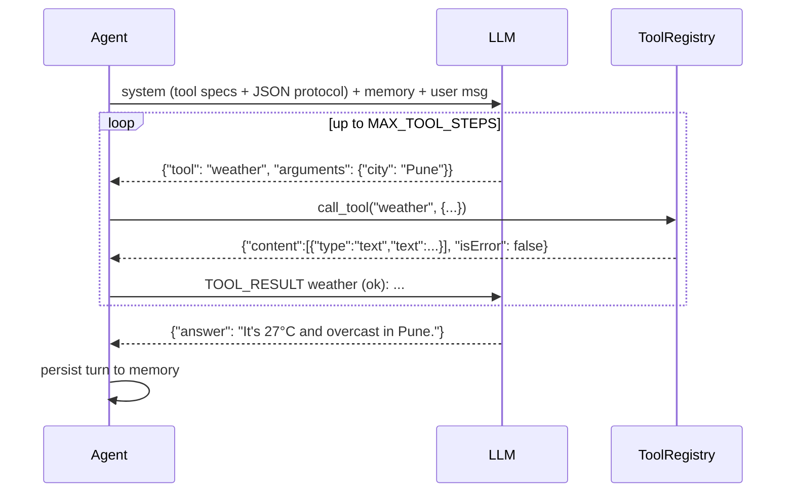

# Jarvis: Personal AI Agent

A terminal-first personal assistant that **calls tools** to do things: math, weather, notes, reminders,
file search and system info. It remembers the conversation across sessions, and you can **talk to it** if you install the voice extras.
Tools live in an **MCP-style registry** (`name` / `description` / `inputSchema`), so the same tools can later be
served over the Model Context Protocol, or external MCP tools can be mounted in.

```
You: remind me to submit the ML assignment in 2 hours
  ↳ add_reminder({"text": "submit the ML assignment", "when": "in 2 hours"}) -> Reminder #1 set for 2026-...
Jarvis: Done, I'll remind you in 2 hours.
```

## Architecture



### Agent loop



The model replies with a single JSON object: either a tool call or an answer. That works the same on every provider,
including small local Ollama models, and the parser copes with code fences and stray prose around the JSON.

## Tools

| Tool | What it does |
|---|---|
| `calculator` | Evaluates math through a whitelisted AST walk (never `eval`). Supports `sqrt`, `log`, `pi`, `^`, … |
| `weather` | Current conditions from the free Open-Meteo API (no key) |
| `web_search` | Stub. Swap in Tavily, SerpAPI or Brave by replacing one function |
| `add_note` / `list_notes` / `delete_note` | Notes stored in SQLite |
| `add_reminder` / `list_reminders` / `complete_reminder` | ISO or relative times (`in 30 minutes`, `2 hours`, `1 day`), with an overdue flag |
| `file_search` | Searches file names or contents, only under `FILE_SEARCH_ROOTS`. Skips hidden folders and `node_modules` |
| `system_info` | OS, Python, CPUs, disk, local time |

Adding a tool takes one decorator. The JSON schema is built from the type hints:

```python
@registry.register()
def stock_price(ticker: str) -> dict:
    """Latest price for a stock ticker."""
    ...
```

## Quickstart

```bash
python -m venv .venv && source .venv/bin/activate
pip install -r requirements-dev.txt
cp .env.example .env              # LLM_PROVIDER=mock works offline (keyword router)

python -m jarvis                  # interactive; /tools, /clear, exit
python -m jarvis -q "weather in Mumbai" --verbose
python -m jarvis --tools          # print MCP tool specs as JSON
```

Real models:

```bash
LLM_PROVIDER=groq   LLM_MODEL=llama-3.3-70b-versatile GROQ_API_KEY=...
LLM_PROVIDER=openai LLM_MODEL=gpt-4o-mini            OPENAI_API_KEY=...
LLM_PROVIDER=ollama LLM_MODEL=llama3.1               # local
```

Voice mode:

```bash
pip install -r requirements-voice.txt   # SpeechRecognition, pyttsx3, PyAudio
python -m jarvis --voice
```

If the extras aren't installed, Jarvis prints a notice and falls back to text.

Docker (text mode):

```bash
docker build -t jarvis .
docker run -it --rm --env-file .env -v $PWD/data:/data -v $HOME/Documents:/files:ro jarvis
```

## Configuration

| Variable | Default | Notes |
|---|---|---|
| `LLM_PROVIDER` / `LLM_MODEL` | `mock` / `llama3.1` | |
| `MAX_TOOL_STEPS` | `5` | tool calls per user message |
| `MEMORY_WINDOW` | `12` | past messages sent with each prompt |
| `DATA_DIR` | `./data` | SQLite DB location |
| `FILE_SEARCH_ROOTS` | `.` | comma-separated allow-list |
| `ALLOW_NETWORK` | `true` | turns off network tools when set to false |
| `VOICE_ENABLED` | `false` | same as `--voice` |

## Tests

```bash
pytest -q
```

Everything runs offline. `ScriptedLLM` replays fixed tool-call sequences, and weather goes through `httpx.MockTransport`.
SQLite runs in memory and the files live in a temp dir. The tests cover schema generation, argument validation and coercion, rejecting unsafe calculator input,
multi-step tool use, the step limit, tool errors fed back to the model, memory across turns and its window, the CLI loop, and the fallback when voice isn't installed.

## Design decisions

- **The model never sees an exception.** Tool failures come back as MCP `isError` results, so the model can explain the problem or try another way.
- **Least privilege.** File search only covers allow-listed roots, the calculator only allows whitelisted operations, and network tools can be switched off.
- **The registry speaks MCP shapes.** It's ready to be wrapped in an MCP server (stdio/SSE) or to be fed by an MCP client.

## Roadmap

- Serve the registry as a real MCP server, and mount external MCP servers as tools
- Background reminder notifications (desktop notifications / scheduler)
- Native function-calling for providers that support it
- Wake-word detection for voice mode
